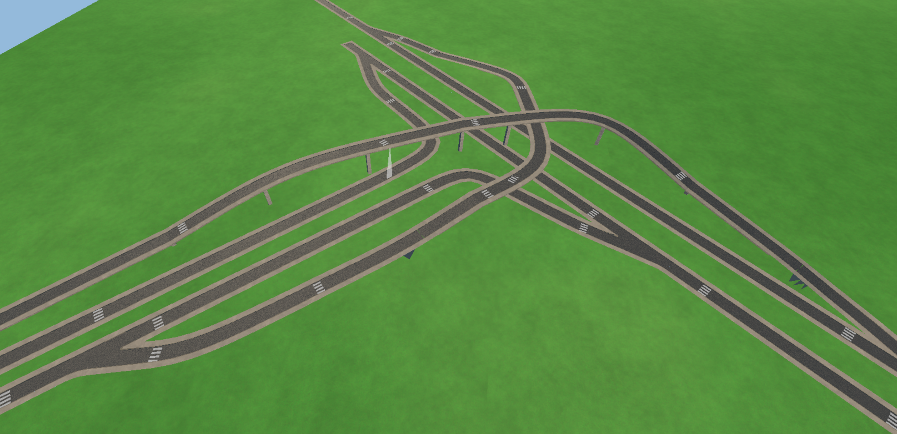

# METRUM RISE

## Description
Open source city building game built with the Godot game engine and Rust programming language.
License: [GNU General Public License, version 3 or later (GPL-3.0-or-later)](LICENSE.md)

Copyright © 2026 the Metrum Rise authors, see [CREDITS.md](CREDITS.md).

## Requirements
- Godot
- Rust
- Git LFS
- Linux, MacOS, WSL2

## How-to

Before cloning for the first time, make sure Git LFS is set up on your
machine (once per machine, not per clone):
```
git lfs install
```

Then clone the repository:
```
git clone https://github.com/jmkekala/metrum_rise.git
```

To start the game, run the following command in terminal:
```
./run.sh --release
```

For asset editor
```
./run.sh --release --asset-editor
```

There are also economy and world editor. But these are not update in awhile so they are not that usable currently.


## Bugs
Loads of bugs

## Credits
Authors, assets and third-party software are listed in [CREDITS.md](CREDITS.md).

## Contributing
Contributions are accepted under the same licence as the project, `GPL-3.0-or-later`. You keep
the copyright in your work. Add your name to [CREDITS.md](CREDITS.md) with your first change.


## Screenshots

### Main gameplay

### Nightview

### Asset editor

### My First attempt to do t-junction



## State of the Game (10/2026)
[](https://youtu.be/g77z47cO7kM)
